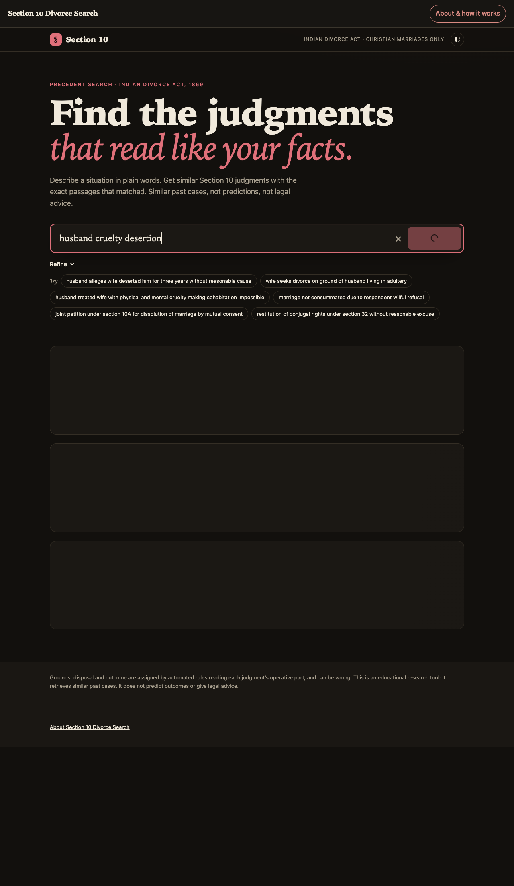
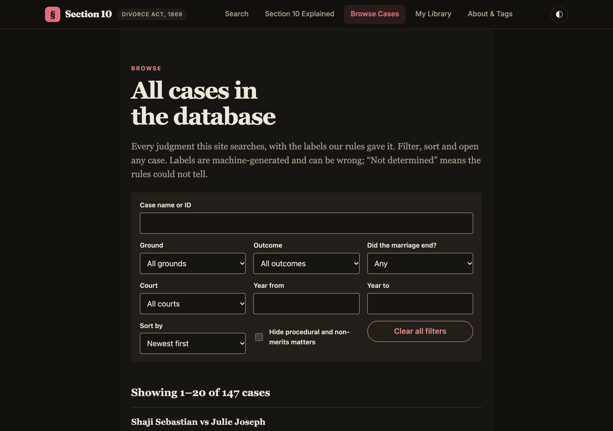
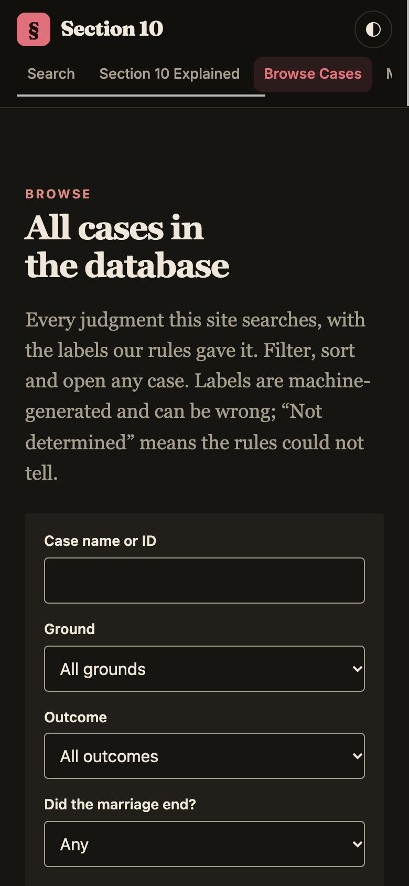
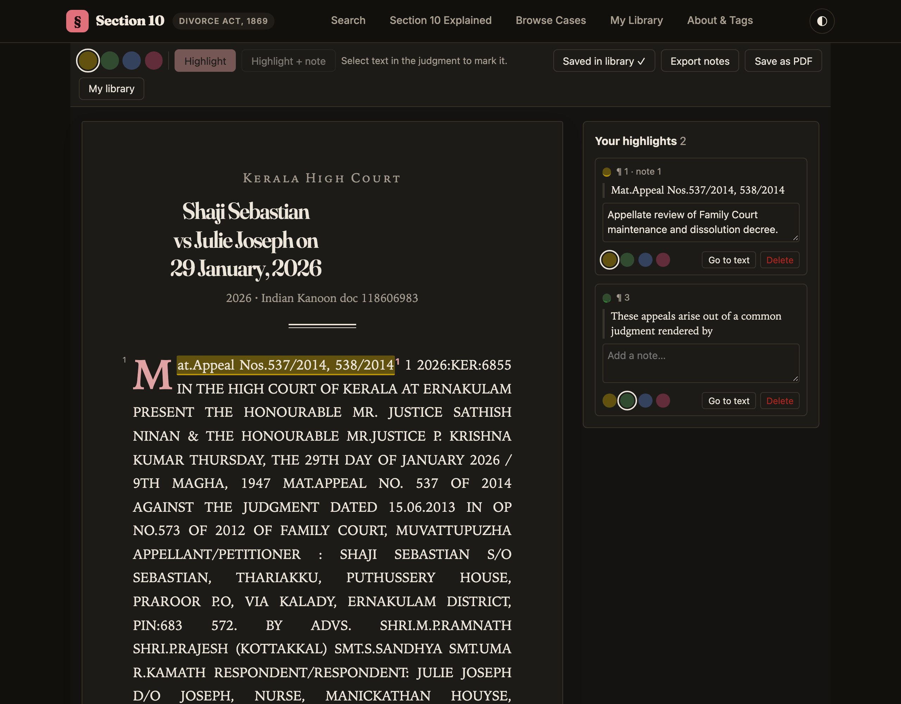
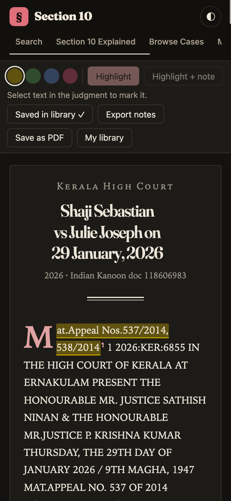
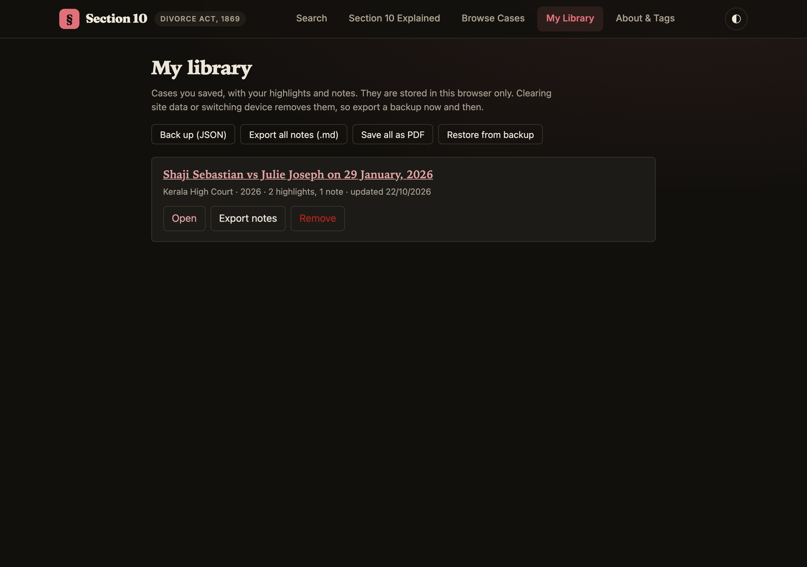
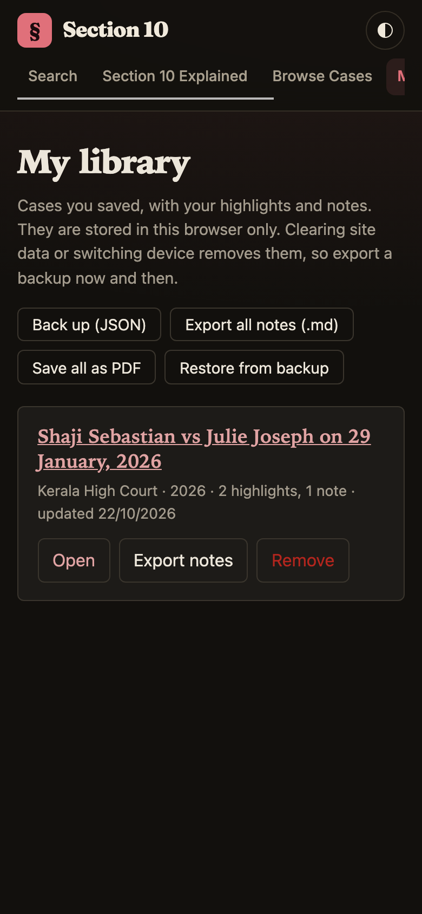
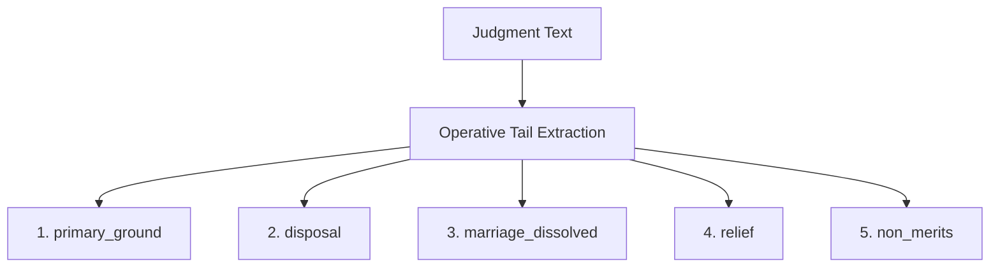
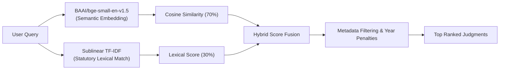

---
annotations_creators:
- machine-generated
- expert-audited
language:
- en
- hi
- mr
- ml
- ta
- te
- bn
- gu
- kn
- pa
license: cc-by-4.0
multilinguality:
- multilingual
size_categories:
- n<1K
source_datasets:
- original
task_categories:
- text-retrieval
- text-classification
pretty_name: Section 10 Indian Divorce Act Precedent Corpus & Multilingual Search
tags:
- legal
- indian-law
- divorce-act-1869
- case-law
- judgments
- court-decisions
- multilingual
- indic-nlp
- matrimonial-law
- high-court-judgments
---

# Section 10 Indian Divorce Act Precedent Search

[](https://www.python.org/)
[](https://fastapi.tiangolo.com/)
[](https://vitejs.dev/)
[](tests/)
[](https://huggingface.co/datasets/AnmolGV/section10-divorce-corpus)
[](render.yaml)

A specialized precedent intelligence and semantic search engine for reported decisions under **Section 10 of the Indian Divorce Act, 1869** (Christian matrimonial law in India). Designed specifically for advocates, legal practitioners, and researchers to assess factual scenarios, evidentiary burdens, statutory defenses, and judicial likelihood without creative hallucinations or cloud data leakage.

---

## Interactive Web Interface & Feature Showcase

### 1. Factual Scenario Search & Grounded Precedent Summary
Search reported decisions using plain factual narratives. The hybrid engine matches similar matrimonial disputes and extracts verified legal summaries cited with jump links.



### 2. Case Law Explorer (`#/cases`)
Filter, sort, and search across all 429 substantive High Court and Supreme Court rulings spanning 24 jurisdictions across India. Filter by ground (cruelty, desertion, adultery, nullity, 10A mutual consent), procedural disposal, or marital outcome.

| Desktop Explorer (1280px) | Mobile Explorer (390px) |
| :---: | :---: |
|  |  |

### 3. Manuscript Case Reader (`#/read/<docId>`)
An in-browser reading environment styled with classic legal typography, drop caps, paragraph line numbers, and active annotation tools:
- **4-Color Highlights**: Yellow, Green, Blue, Pink highlighting with text selection.
- **Footnotes & Margin Notes**: Add case notes anchored to quotes; footnotes renumber dynamically.
- **Save as PDF**: Print styled judgments with highlights, footnote numbers, and formatted endnotes.

| Desktop Reader with Notes & Highlights | Mobile Reader Experience |
| :---: | :---: |
|  |  |

### 4. Personal Case Library (`#/library`)
Save relevant authorities directly to your browser's local library. Highlights and notes persist privately on your machine:
- **JSON Backup & Restore**: Export your library to JSON for backup or transfer between workstations.
- **Markdown Export**: Export all notes and quotes formatted for pleading briefs.
- **Batch PDF Export**: Compile your saved library into a single printable report.

| Desktop Library View | Mobile Library View |
| :---: | :---: |
|  |  |

---

## Table of Contents

- [Overview](#overview)
- [Interactive Web Interface & Feature Showcase](#interactive-web-interface--feature-showcase)
- [Curated Judgment Corpus](#curated-judgment-corpus)
- [Comprehensive Taxonomy & Legal Tags](#comprehensive-taxonomy--legal-tags)
  - [1. Primary Grounds (`primary_ground`)](#1-primary-grounds-primary_ground)
  - [2. Court Disposal (`disposal`)](#2-court-disposal-disposal)
  - [3. Marital Status Decree (`marriage_dissolved`)](#3-marital-status-decree-marriage_dissolved)
  - [4. Specific Relief Granted (`relief`)](#4-specific-relief-granted-relief)
  - [5. Procedural / Non-Merits Flag (`non_merits`)](#5-procedural--non-merits-flag-non_merits)
  - [6. Paragraph Rhetorical Roles (`role`)](#6-paragraph-rhetorical-roles-role)
- [Search & Intelligence Architecture](#search--intelligence-architecture)
  - [Dual SLM + Lexical Hybrid Engine](#dual-slm--lexical-hybrid-engine)
  - [Extractive Precedent Summaries](#extractive-precedent-summaries)
  - [Advocate Intelligence Guidance](#advocate-intelligence-guidance)
- [Hugging Face Dataset Integration](#hugging-face-dataset-integration)
- [Render Cloud Deployment](#render-cloud-deployment)
- [Local Development & Setup](#local-development--setup)
- [API Reference](#api-reference)
- [Verification & Test Suite](#verification--test-suite)
- [License & Ethical Disclaimer](#license--ethical-disclaimer)

---

## Overview

General-purpose chatbots and large cloud LLMs are hazardous for legal practice: they frequently fabricate case citations, misquote statutes, hallucinate bench ratios, and compromise sensitive matrimonial facts by streaming them to third-party commercial servers.

This system replaces open-ended text generation with a **Compound Small Language Model (SLM) & Deterministic Legal Taxonomy Pipeline**:
- **Zero Hallucinations**: Every matched snippet, holding, and citation links directly to the original Indian Kanoon judgment record.
- **100% Confidentiality & Local Processing**: Precomputed 384-dimensional dense vectors and sublinear TF-IDF run on local CPU without sending client narratives to the cloud.
- **Deterministic Legal Taxonomies**: Every case is audited and tagged using strict legal heuristics matching the statutory architecture of the Indian Divorce Act.

---

## Curated Judgment Corpus

The dataset comprises **429 audited substantive judgments** of the Supreme Court of India and High Courts spanning 24 jurisdictions across India from 1869 to 2026.

```
Total Candidate Documents Evaluated: 2,126
  ├── Kanoon Query Streams Swept:            22 (Section 10, 10A, 11, 19, 22, 32, 37, grounds, and regional court feeds)
  ├── Procedural Orders & Irrelevant Acts Dropped: 1,697 (CrPC s.125 revisions, SMA s.27, procedural mentions)
  └── Retained Substantive Corpus:           429 Substantive Judgments across 24 Jurisdictions
```

### Nationwide Jurisdiction Breakdown
- **Southern India**: Madras High Court (69), Kerala High Court (63), Karnataka High Court (24), Andhra Pradesh High Court (16), Telangana High Court (4)
- **Western India**: Bombay High Court (33), Gujarat High Court (8)
- **Northern India**: Delhi High Court (26), Allahabad High Court (21), Punjab-Haryana High Court (16), Rajasthan High Court (17), Himachal Pradesh High Court (11)
- **Eastern & Central India**: Calcutta High Court (24), Jharkhand High Court (20), Orissa High Court (19), Gauhati High Court (12), Patna High Court (11), Madhya Pradesh High Court (10), Tripura High Court (1)
- **Apex Court & Advisory**: Supreme Court of India (21), Law Commission of India Reports (3)

### Scope Boundary Rules
- **Retained**:
  - Petitions under Section 10 grounds (adultery, cruelty, desertion, non-consummation, unsoundness of mind, leprosy, venereal disease).
  - Mutual consent petitions under Section 10A (including constitutional separation period challenges).
  - Nullity suits under Section 18 and Section 19.
  - Confirmation references under historic Section 16 and Section 17.
  - Landmark constitutional equality cases (e.g., *Mary Sonia Zachariah*, *Pragati Varghese*, *Ammini E.J.*) that struck down gender-discriminatory burdens on wives.
- **Systematically Filtered Out**:
  - Maintenance revisions under Sections 125/126/482 CrPC (e.g. Doc `731260` *V.D. Solomon*).
  - Petitions under Section 27 of the Special Marriage Act, 1954 (e.g. Doc `190445477` *Dr. Kiran Kumar*).
  - Hindu Marriage Act petitions with incidental references to Christian law.
  - Statutory rulebooks, Section text definitions, and Law Commission gazettes (e.g. Docs `724824`, `37740179`, `110842511`).

---

## Comprehensive Taxonomy & Legal Tags

Every judgment in the corpus is classified across five orthogonal dimensions in `data/labeled/cases.jsonl`. These tags are generated deterministically by judicial tail analysis in [`src/labels.py`](file:///Users/ananyasridhar/.gemini/antigravity/scratch/section10-divorce-search/src/labels.py) and audited against primary case law.



### 1. Primary Grounds (`primary_ground`)

Identifies the core legal anchor or matrimonial fault adjudicated by the court:

| Tag | Statutory Provision | Legal Definition & Rule Criteria | Corpus Count |
| :--- | :--- | :--- | :---: |
| `adultery` | Section 10(1)(i) | Voluntary sexual intercourse outside marriage. Evaluated on circumstantial evidence establishing **inclination and opportunity**. Requires adherence to Section 11 mandatory co-respondent joinder. | **91** |
| `cruelty` | Section 10(1)(x) | Conduct causing reasonable apprehension of danger to life, limb, or mental health. Covers persistent mental harassment, false accusations of unchastity, expulsion from matrimonial home, and physical abuse. | **88** |
| `unclear` | — | Ground cannot be deterministically resolved from the operative tail or issues framed. | **86** |
| `desertion` | Section 10(1)(ix) | Total repudiation of marital obligations without reasonable cause for a continuous statutory period of **not less than two years** immediately preceding petition presentation (*factum separationis* + *animus deserendi*). | **37** |
| `procedural` | Sections 7, 8, 11, 45 | Cases resolved on jurisdiction, transfer petitions, delay/laches, co-respondent joinder dispensation, or procedural appeals without determination on substantive marital fault. | **36** |
| `constitutional_validity` | Articles 14, 15, 21 | Constitutional challenges to statutory provisions of the Divorce Act (e.g. striking down Section 10's dual-fault burden on wives or Section 10A's mandatory waiting period). | **30** |
| `nullity_sec19` | Sections 18, 19 | Declaration of marriage as null and void based on pre-existing statutory impediments: impotence existing at marriage and trial, force/fraud, or lunacy/idiocy. | **26** |
| `mutual_consent_10A` | Section 10A | Joint petition filed by both spouses alleging mutual agreement to dissolve marriage after living separately for the statutory period. | **23** |
| `unsound_mind` | Section 10(1)(iii) | Incurable unsoundness of mind for a continuous period of at least two years immediately preceding the petition. | **4** |
| `non_consummation` | Section 10(1)(vii) | Wilful and persistent refusal by the respondent spouse to consummate the marriage despite opportunity. | **3** |
| `conversion` | Section 10(1)(ii) | Respondent ceased to be Christian by converting to another religion. | **2** |
| `wife_specific` | Section 10(2) | Additional grounds exclusive to wives: husband guilty of rape, sodomy, or bestiality since marriage solemnization. | **1** |
| `venereal_disease` | Section 10(1)(v) | Respondent suffering from venereal disease in a communicable form for at least two years. | **1** |
| `leprosy` | Section 10(1)(iv) | Respondent suffering from virulent and incurable form of leprosy. | **1** |

---

### 2. Court Disposal (`disposal`)

Classifies the formal procedural disposition of the appeal or original petition:

| Tag | Legal Meaning | Example Judicial Phrasing | Corpus Count |
| :--- | :--- | :--- | :---: |
| `allowed` | Petition, appeal, or revision accepted; prayer granted. | *"Appeal is allowed. The judgment of the trial court is set aside."* | **131** |
| `dismissed` | Prayer refused, petition dismissed, or lower court dismissal upheld. | *"The petition stands dismissed with no order as to costs."* | **128** |
| `unclear` | Order disposition wording cannot be deterministically mapped. | *"Ordered accordingly"*, *"Let notice issue"*, *"Records returned."* | **55** |
| `confirmed` | High Court Full Bench confirmed District Court decree under historic Section 17. | *"The decree for dissolution passed by the District Judge is confirmed."* | **27** |
| `partly_allowed` | Relief partially granted (e.g., divorce denied but judicial separation or alimony granted). | *"Appeal is allowed in part; decree of divorce denied, maintenance confirmed."* | **26** |
| `remanded` | Order set aside and remanded to trial court for fresh evidence or retrial. | *"The case is remanded to the Family Court for fresh disposal on merits."* | **24** |
| `disposed_of` | Proceeding closed without a merits finding (e.g., transfer granted or settlement recorded). | *"The transfer petition is disposed of in terms of the joint memo."* | **22** |
| `not_confirmed` | High Court refused to confirm decree nisi under historic Section 17. | *"We decline to confirm the decree for dissolution of marriage."* | **10** |
| `interim` | Interlocutory ruling deciding maintenance pendente lite or interim custody. | *"Application for interim alimony under Section 36 is disposed of."* | **4** |
| `modified` | Trial court decree affirmed with modified financial or custody terms. | *"The decree of the lower court is modified to the extent of alimony."* | **2** |

---

### 3. Marital Status Decree (`marriage_dissolved`)

Records whether the legal bond of marriage was severed by the court's decree:

| Tag | Legal Consequence | Qualifying Scenarios | Corpus Count |
| :--- | :--- | :--- | :---: |
| `unclear` | Marital status undetermined | Case remanded, transfer petition, interim order, or ruling not determining the marital tie. | **259** |
| `yes` | **Marriage Legally Terminated** | Decree of dissolution granted (`allowed`), decree nisi confirmed (`confirmed`), or marriage declared null and void (`nullity`). | **113** |
| `no` | **Marriage Intact** | Petition dismissed (`dismissed`), confirmation refused (`not_confirmed`), or only judicial separation/restitution granted. | **57** |

---

### 4. Specific Relief Granted (`relief`)

Captures the precise substantive remedy awarded:

| Tag | Statutory Basis | Legal Significance | Corpus Count |
| :--- | :--- | :--- | :---: |
| `unclear` | — | Relief not determinable from the operative text (or proceedings remanded/interlocutory). | **259** |
| `dissolution` | Sections 10, 10A | Absolute divorce: matrimonial tie ended; parties free to remarry. | **100** |
| `none` | — | All matrimonial relief denied; petition dismissed. | **38** |
| `judicial_separation` | Section 22 | Parties relieved of cohabitation duty, but marital tie remains legally subsisting. | **17** |
| `nullity` | Sections 18, 19 | Marriage declared void ab initio (or annulled) due to pre-existing statutory impediment. | **13** |
| `restitution` | Section 32 | Order directing the respondent spouse to resume cohabitation. | **2** |

---

### 5. Procedural / Non-Merits Flag (`non_merits`)

A boolean indicator distinguishing substantive trials of matrimonial misconduct from ancillary procedural rulings:

| Tag | Description | Corpus Count |
| :--- | :--- | :---: |
| `False` | **Substantive Judgment**: Court heard evidence, witness testimonies, and legal arguments adjudicating the matrimonial fault. | **401** |
| `True` | **Non-Merits / Procedural Ruling**: Matter decided strictly on jurisdiction, forum convenience, transfer of proceedings between courts, delay condonation, or Section 36 interim maintenance. | **28** |

---

### 6. Paragraph Rhetorical Roles (`role`)

Every paragraph across the 13,263 chunks in `data/index/meta.parquet` is labeled by its rhetorical purpose in the judicial opinion:

| Tag | Rhetorical Function | Key Identifying Cues |
| :--- | :--- | :--- |
| `facts` | Marital background, dates of solemnization, domestic cohabitation history. | Default narrative baseline in opening recitals. |
| `issue` | Points framed for judicial determination. | *"question for consideration"*, *"points that arise"*, *"whether"*. |
| `petitioner_argument` | Submissions, allegations, and testimony on behalf of the moving spouse. | *"counsel for the appellant"*, *"petitioner contended"*, *"alleged by"*. |
| `respondent_argument` | Rebuttals, defenses, denials, and counter-affidavits of the answering spouse. | *"respondent denied"*, *"counter-affidavit"*, *"written statement"*. |
| `law` | Statutory analysis, legal interpretations, and precedent citations. | Section citations, sub-sections, AIR/SCC/ILR law report citations. |
| `court_reasoning` | Substantive bench analysis, evidentiary evaluation, and credibility assessments. | *"in our opinion"*, *"we hold"*, *"having regard to"*, *"it is evident"*. |
| `conclusion` | Operative disposal, decree declaration, and costs orders. | *"in the result"*, *"appeal is allowed/dismissed"*, *"decree passed"*. |

---

## Search & Intelligence Architecture

### Dual SLM + Lexical Hybrid Engine



1. **Semantic Understanding (70% weight)**:
   - Employs `BAAI/bge-small-en-v1.5` (compact 33-million parameter transformer, 384-dimensional dense vectors).
   - Projects natural-language narratives (e.g. *"husband deserted home and refused to provide maintenance"*) into conceptual embedding space, retrieving factually analogous precedents even when courts used different vernacular.
2. **Statutory Lexical Precision (30% weight)**:
   - Fits a sublinear TF-IDF index (`ngram_range=(1,2)`) across 13,263 judgment chunks.
   - Captures exact legal terms of art: `animus deserendi`, `Section 10(1)(x)`, `condonation under section 14`, `decree nisi`, `Section 11 co-respondent`.
3. **Anchor Tag Spacing Regularization**:
   - Custom Kanoon HTML preprocessor inserts whitespace around `<a>` elements (`a.insert_before(" ")`, `a.insert_after(" ")`).
   - Completely eliminates conjoined tokens (`underSection 10of` &rarr; `under Section 10 of`), ensuring 100% token recall for statutory terms.

### Multilingual Indic Precedent Search

Litigants, family counselors, and regional practitioners often formulate matrimonial inquiries in their mother tongue. The platform incorporates a native **Indic Legal Lexicon & Cross-Lingual Search Pipeline** in [`src/multilingual.py`](file:///Users/ananyasridhar/.gemini/antigravity/scratch/section10-divorce-search/src/multilingual.py):
- **Deterministic Script Detection**: Automatically detects Unicode character ranges for 8 major Indian scripts: Devanagari (Hindi, Marathi), Malayalam, Tamil, Telugu, Bengali, Gujarati, Kannada, and Gurmukhi (Punjabi).
- **Statutory Legal Lexicon Mapping**: Maps vernacular matrimonial terminology (e.g. `क्रूरता` &rarr; `cruelty`, `परित्याग` &rarr; `desertion`, `विवाह विच्छेद` / `വിവാഹമോചനം` &rarr; `divorce dissolution`, `व्यभिचार` &rarr; `adultery`, `आपसी सहमति` &rarr; `mutual consent 10A`, `ശാരീരിക പീഡനം` &rarr; `cruelty physical abuse`, `భార్య నిర్లక్ష్యం` &rarr; `neglect desertion`) to precise statutory grounds under the Indian Divorce Act, 1869.
- **Bilingual Badge & Original Citation**: Search results clearly display the detected language, normalized legal search term, and direct links to the official Kanoon judgment transcript.

### Extractive Precedent Summaries

The `/api/summary` endpoint provides grounded legal summaries:
- **Default Mode (`extractive`)**: Deterministically compiles summaries directly from verified judgment cards, case labels, and highest-scoring matched passages. No external network requests or LLM dependencies.
- **Optional AI Mode (`SUMMARY_LLM=1`)**: When enabled with an API key, an LLM drafts a concise synthesis strictly conditioned on the returned cases. Output is validated with a strict citation checker: any response with ungrounded citations `[n]` or missing references automatically falls back to the deterministic summary.

### Advocate Intelligence Guidance

The search engine augments search results with actionable practice intelligence:
- **Operative Grant Ratio**: Calculates the percentage of merits rulings where dissolution or nullity was granted vs dismissed.
- **Evidentiary Roadmaps**: Outlines judicial evidentiary requirements (medical board reports, letters, police complaints, continuous cohabitation records).
- **Statutory Traps**: Flags statutory defenses such as **Section 14 Condonation** (resumption of cohabitation extinguishing cause of action) and **Section 11 Mandatory Joinder** (failure to implead the alleged adulterer).
- **Litigation Checklist**: Practical 4-step pleading checklist for drafting petitions.

---

## Hugging Face Dataset Integration

The entire audited dataset, precomputed indices, and audit reports are published on Hugging Face:

📦 **Dataset Hub**: [https://huggingface.co/datasets/AnmolGV/section10-divorce-corpus](https://huggingface.co/datasets/AnmolGV/section10-divorce-corpus)

### Loading with Python

```python
import pandas as pd
from datasets import load_dataset

# 1. Load the 429 audited labeled cases
cases_df = pd.read_json("hf://datasets/AnmolGV/section10-divorce-corpus/data/labeled/cases.jsonl", lines=True)
print(f"Loaded {len(cases_df)} labeled cases")
print(cases_df[["doc_id", "title", "primary_ground", "disposal", "marriage_dissolved"]].head())

# 2. Load the 13,263 precomputed chunk metadata records
meta_df = pd.read_parquet("hf://datasets/AnmolGV/section10-divorce-corpus/data/index/meta.parquet")
print(f"Loaded {len(meta_df)} chunks across {meta_df['doc_id'].nunique()} judgments")
```

---

## Render Cloud Deployment

The repository includes a ready-to-deploy [`render.yaml`](file:///Users/ananyasridhar/.gemini/antigravity/scratch/section10-divorce-search/render.yaml) blueprint.

### Option 1: Via Render CLI
```bash
# 1. Authenticate with Render
render login

# 2. Validate the blueprint
render blueprints validate ./render.yaml

# 3. Launch deployment
render blueprints deploy
```

### Option 2: Via Render Dashboard (One-Click)
1. Go to [dashboard.render.com](https://dashboard.render.com).
2. Click **New** &rarr; **Blueprint**.
3. Select your GitHub repository: `Anmolgv05/indian-divorce-act-precedents`.
4. Render will parse `render.yaml`, install Python dependencies from `requirements.txt`, and serve the production web application on Uvicorn.

---

## Local Development & Setup

### Prerequisites
- Python 3.11+
- Node.js 18+ and npm

### 1. Clone & Set Up Backend
```bash
git clone https://github.com/Anmolgv05/indian-divorce-act-precedents.git
cd indian-divorce-act-precedents

# Create virtual environment
python3 -m venv .venv
source .venv/bin/activate

# Install dependencies
pip install -r requirements.txt
```

### 2. Build Frontend
```bash
cd frontend
npm install
npm run build
cd ..
```

### 3. Run the Server
```bash
# Launch FastAPI backend serving production frontend at http://localhost:8000
python api.py
```

For hot-reloading development:
```bash
# Terminal 1: FastAPI API
uvicorn api:app --reload --port 8000

# Terminal 2: Vite Dev Server (with preconfigured /api proxy)
cd frontend && npm run dev
```

---

## API Reference

### 1. Search Precedents (`POST /api/search`)
```bash
curl -X POST http://127.0.0.1:8000/api/search \
  -H "Content-Type: application/json" \
  -d '{
    "query": "husband cruelty desertion without cause",
    "ground": "cruelty",
    "top_k": 5
  }'
```

#### Response Structure:
```json
{
  "results": [
    {
      "doc_id": "186623837",
      "title": "Lavina Martin vs Sam Bosco Martin on 21 March, 2017",
      "year": 2017,
      "court": "Bombay High Court",
      "url": "https://indiankanoon.org/doc/186623837/",
      "score": 0.842,
      "primary_ground": "cruelty",
      "disposal": "allowed",
      "marriage_dissolved": "yes",
      "relief": "dissolution",
      "non_merits": false,
      "outcome_summary": "Bombay High Court: decree for dissolution of marriage granted on cruelty substantiated by persistent physical/mental harassment making cohabitation intolerable.",
      "best_chunk": {
        "text": "The Respondent-husband had sought divorce on the ground of cruelty...",
        "segment_type": "reasoning"
      }
    }
  ],
  "stats": {
    "n_retrieved": 5,
    "ended": 3,
    "did_not_end": 1,
    "unclear_or_na": 1,
    "outcome_synthesis": "Across the 5 most relevant precedents: dissolution granted in 3 case(s)...",
    "precedent_guidance": {
      "grant_rate_pct": 75,
      "evidentiary_roadmaps": [...],
      "statutory_traps": [...],
      "litigation_checklist": [...]
    }
  }
}
```

### 2. Generate Grounded Summary (`POST /api/summary`)
```bash
curl -X POST http://127.0.0.1:8000/api/summary \
  -H "Content-Type: application/json" \
  -d '{
    "query": "wife seeks divorce on cruelty",
    "results": [...]
  }'
```

---

## Verification & Test Suite

The test suite consists of **118 automated tests** covering parsing, scraping, anchor spacing, taxonomy label rules, and search scoring:

```bash
PYTHONPATH=src pytest tests/
```

```
============================= test session starts ==============================
collected 118 items

tests/test_api.py ......                                                 [  5%]
tests/test_labels.py ................................................... [ 48%]
......................................                                   [ 80%]
tests/test_parse_clean.py .....                                          [ 84%]
tests/test_scrape.py ....                                                [ 88%]
tests/test_search.py .......                                             [ 94%]
tests/test_summarize.py .....                                            [ 98%]
tests/test_validate.py ..                                                [100%]

======================= 118 passed, 3 warnings in 17.69s =======================
```

---

## License & Ethical Disclaimer

- **License**: MIT License (Code) / CC-BY-4.0 (Corpus Annotations & Dataset Card).
- **Public Domain Judicial Records**: Primary court judgments are public domain legal documents indexed via Indian Kanoon.
- **Educational & Research Aid**: This system is designed strictly for legal research, academic case analysis, and precedent exploration. Automated classification tags and outcome syntheses are rule-generated heuristics and **do not constitute legal advice or predictive outcome guarantees**. Always consult original judgments in primary law reports (SCC, AIR, ILR) and qualified legal counsel.
